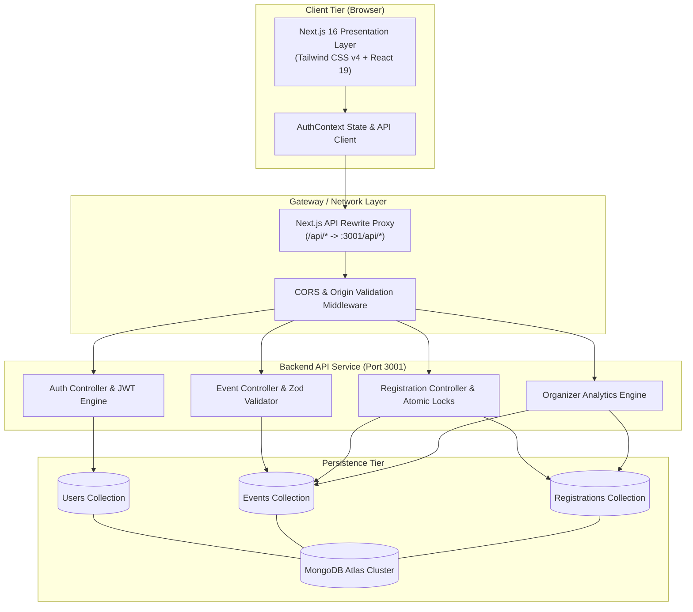
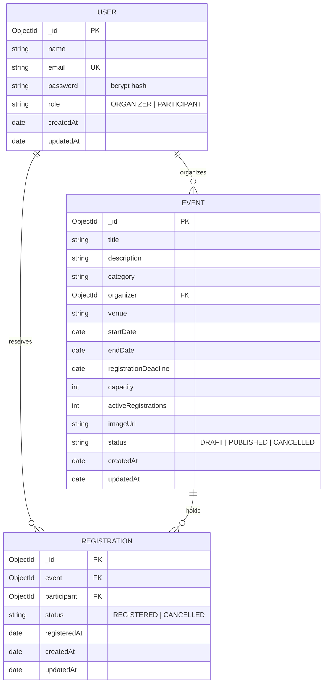

# CampusConnect — Smart Campus Event Management System

<div align="center">

[](https://nextjs.org/)
[](https://react.dev/)
[](https://www.typescriptlang.org/)
[](https://www.mongodb.com/)
[](https://tailwindcss.com/)
[](LICENSE)

<p align="center">
  <strong>A full-stack, enterprise-grade campus event orchestration and registration platform engineered with atomic capacity control, role-based workflows, and real-time community engagement.</strong>
</p>

[Key Features](#-key-features) •
[Architecture](#-system-architecture) •
[Installation & Setup](#-installation-and-setup-instructions) •
[API Documentation](#-api-documentation) •
[Database Design](#-database-design) •
[Security](#-security-and-credential-management)

</div>

---

## 📖 Table of Contents

- [Project Overview](#-project-overview)
- [Problem Statement](#-problem-statement)
- [Our Solution](#-our-solution)
- [Key Features](#-key-features)
  - [Student Dashboard](#student-dashboard)
  - [Event Discovery and Browsing](#event-discovery-and-browsing)
  - [Search and Category Filtering](#search-and-category-filtering)
  - [Atomic Event Registration](#atomic-event-registration)
  - [My Registrations & Self-Service Cancellation](#my-registrations--self-service-cancellation)
  - [Organizer Dashboard & Analytics](#organizer-dashboard--analytics)
  - [Event Creation & Lifecycle Management](#event-creation--lifecycle-management)
  - [Live Attendee Tracking](#live-attendee-tracking)
- [User Roles and Permissions](#-user-roles-and-permissions)
- [Technology Stack](#-technology-stack)
- [System Architecture](#-system-architecture)
  - [Decoupled Client-Server Pipeline](#decoupled-client-server-pipeline)
  - [Atomic Capacity & Concurrency Control](#atomic-capacity--concurrency-control)
  - [System Flow Diagrams](#system-flow-diagrams)
- [Project Directory Structure](#-project-directory-structure)
- [Application Screenshots](#-application-screenshots)
- [Installation and Setup Instructions](#-installation-and-setup-instructions)
  - [Prerequisites](#prerequisites)
  - [1. Clone Repository](#1-clone-repository)
  - [2. Backend Setup](#2-backend-setup)
  - [3. Frontend Setup](#3-frontend-setup)
- [Environment Variables](#-environment-variables)
- [Running the Application](#-running-the-application)
  - [Running the Backend](#running-the-backend)
  - [Running the Frontend](#running-the-frontend)
- [API Documentation](#-api-documentation)
  - [Standard API Response Format](#standard-api-response-format)
  - [Endpoints Reference](#endpoints-reference)
- [Database Design](#-database-design)
  - [Data Models & Collections](#data-models--collections)
  - [Entity-Relationship Diagram](#entity-relationship-diagram)
- [Authentication and Authorization](#-authentication-and-authorization)
- [Security and Credential Management](#-security-and-credential-management)
- [Future Improvements](#-future-improvements)
- [Contributors](#-contributors)
- [Acknowledgements](#-acknowledgements)

---

## 🌟 Project Overview

**CampusConnect (Smart-Campus-Event-Management-System)** is a modern, responsive web application engineered to centralize and automate university event discovery, seat booking, and club/department administration. 

Designed with a decoupled **Next.js frontend** and **Next.js App Router REST API backend**, the platform enables university students to seamlessly find upcoming hackathons, tech talks, workshops, and cultural fests while guaranteeing organizers complete oversight over ticketing, venue constraints, and participant rosters.

Unlike conventional university event portals that suffer from race conditions under high concurrent demand, CampusConnect incorporates **atomic MongoDB reservation primitives** that eliminate overbooking, enforce strict deadlines, and handle cancellations gracefully.

---

## ❗ Problem Statement

Higher education institutions face recurring operational challenges when managing extra-curricular, co-curricular, and departmental events:

1. **Information Fragmentation**: Campus notices are scattered across social media channels, messaging apps, and bulletin boards, causing students to miss valuable deadlines and networking opportunities.
2. **Race Conditions & Overbooking**: High-demand masterclasses and hackathons with limited lab or auditorium capacities frequently suffer from seat over-allocation when multiple participants submit booking requests simultaneously.
3. **Manual Organizer Overhead**: Student clubs and department coordinators spend hours tracking spreadsheets, verifying registrations, and tallying seat capacity by hand.
4. **Poor Cancellation Management**: When students can no longer attend, there is rarely an automated mechanism to release their reserved spots back into the pool for peers.
5. **Security & Authentication Gaps**: Ad-hoc forms fail to authenticate users reliably, leaving registrations vulnerable to duplicate entries and spam.

---

## 💡 Our Solution

**CampusConnect** solves campus event management through a production-ready, full-stack platform:

- **Centralized Event Portal**: A single source of truth for all campus departments, student chapters, and faculty coordinators.
- **Concurrency-Safe Seat Reservation**: Atomic MongoDB reservation updates (`$inc` coupled with capacity inequality criteria) ensure zero overbooking during registration traffic spikes.
- **Dedicated Dual-Role Workspaces**: Tailored interfaces for both **Students/Participants** and **Club/Department Organizers**.
- **Self-Service Attendee Management**: Real-time ticket management allowing students to view active reservations and instantly cancel to restore seats.
- **Hardened Authentication**: Stateless, HTTP-only JWT cookie architecture protected with bcrypt password hashing and rate limiting.

---

## 🚀 Key Features

### Student Dashboard
- **Personalized Portal**: Access via `/participant/dashboard` with personalized greetings and role verification.
- **Real-Time Activity Metrics**: Instant summary counters displaying **Available Events**, **Active Registrations**, and **Upcoming Events**.
- **Dual Workspace Tabs**: Switch effortlessly between the **Browse Events** directory and the personal **My Registrations** ticket history.

### Event Discovery and Browsing
- **Live Campus Feed**: Browse published campus events with dynamic metadata including start/end timestamps, physical venue, host organizer, and live capacity utilization.
- **Dedicated Event Details Page**: Comprehensive information view (`/events/[id]`) with banner visuals, detailed markdown descriptions, schedule breakdowns, venue tags, and live seat progress bars.
- **Real-Time Seat Indicators**: Visual badges and capacity progress bars alerting students when events are nearly full or sold out.

### Search and Category Filtering
- **Full-Text Search**: Search instantly across event titles, detailed descriptions, and venue names.
- **Category Filter Pills**: One-click filtering across campus disciplines:
  - 💻 **Technology** (AI, coding, hackathons, robotics)
  - 🛠️ **Workshop** (Hands-on masterclasses and technical labs)
  - 🎭 **Cultural** (Music, drama, art, campus fests)
  - ⚽ **Sports** (Tournaments, athletics, fitness challenges)
  - 🚀 **Entrepreneurship** (Startup pitches, founder talks, VC panels)
  - 🏆 **Competition** (Case studies, debates, design sprints)
- **Zero-Friction State Reset**: Instant filter clearing when search yields zero matches.

### Atomic Event Registration
- **One-Click Seat Reservation**: Secure seat booking directly from the event page or the student dashboard.
- **Anti-Overbooking Concurrency Shield**: Two-phase atomic reservation algorithm guarantees that capacity is never exceeded, even under concurrent burst traffic.
- **Duplicate Prevention**: Partial compound database indexes enforce that a participant can only possess one active registration per event.
- **Deadline Enforcement**: Automatic server-side rejection for events whose registration deadline has passed.

### My Registrations & Self-Service Cancellation
- **Ticket Roster**: Detailed log of all historical and active registrations showing registration timestamps and current status (`REGISTERED` or `CANCELLED`).
- **Instant Cancellation**: One-click cancellation with immediate database counter rollback, instantly releasing the reserved seat to other interested students.

### Organizer Dashboard & Analytics
- **Organizer Workspace**: Accessible via `/organizer/dashboard` exclusively for accounts with the `ORGANIZER` role.
- **Executive Analytics Overview**: High-level telemetry tracking:
  - Total events created
  - Currently published events
  - Total active student registrations across all managed events
- **Capacity Utilization Tracking**: Visual progress bars and percentage meters showing fill rates for every event.

### Event Creation & Lifecycle Management
- **Interactive Event Builder**: Modal dialog allowing organizers to draft and publish events with:
  - Title, rich description, category, and physical venue.
  - Start date-time and End date-time.
  - Registration deadline.
  - Maximum seat capacity.
  - Optional cover image URL.
  - Publication status: `PUBLISHED` (visible to campus), `DRAFT` (internal staging), or `CANCELLED`.
- **Temporal Integrity Rules**: Strict validation ensuring end dates succeed start dates, and registration deadlines precede or match event commencement.
- **Update & Delete Lifecycle**: Real-time event editing and safe deletion with automatic cascading removal of associated registration records.

### Live Attendee Tracking
- **Participant Roster Modal**: Instant inspection of attendee lists per event.
- **Detailed Attendee Metadata**: Real-time view of student names, university emails, registration timestamps, and enrollment status.

---

## 👥 User Roles and Permissions

CampusConnect enforces strict Role-Based Access Control (RBAC):

| Capability / Resource | Visitor (Unauthenticated) | Participant (`PARTICIPANT`) | Organizer (`ORGANIZER`) |
|---|:---:|:---:|:---:|
| View Landing Page & Public Events | ✅ | ✅ | ✅ |
| View Event Details (`/events/[id]`) | ✅ | ✅ | ✅ |
| Account Registration & Sign In | ✅ | ✅ | ✅ |
| Access Student Dashboard | ❌ | ✅ | ❌ *(Redirected)* |
| Register for Events | ❌ | ✅ | ❌ |
| Cancel Own Registration | ❌ | ✅ | ❌ |
| View "My Registrations" History | ❌ | ✅ | ❌ |
| Access Organizer Dashboard | ❌ | ❌ *(Redirected)* | ✅ |
| Create New Events | ❌ | ❌ | ✅ |
| Edit / Update Owned Events | ❌ | ❌ | ✅ |
| Delete Owned Events | ❌ | ❌ | ✅ |
| View Event Attendee Roster | ❌ | ❌ | ✅ *(Owner only)* |
| Access Organizer Analytics | ❌ | ❌ | ✅ *(Scoped)* |

---

## 🛠️ Technology Stack

| Layer | Technology | Version | Purpose |
|---|---|---|---|
| **Frontend Framework** | [Next.js](https://nextjs.org/) | `16.4.0` | React App Router framework, SSR/CSR, route rewrites |
| **UI Library** | [React](https://react.dev/) | `19.1.1` | Declarative component UI library |
| **Language** | [TypeScript](https://www.typescriptlang.org/) | `5.7.3` (FE) / `5.9.2` (BE) | End-to-end static typing and interface contracts |
| **Styling** | [Tailwind CSS](https://tailwindcss.com/) | `4.3.3` | Utility-first responsive CSS framework with PostCSS |
| **Icons** | [Lucide React](https://lucide.dev/) | `^1.16.0` | Crisp, accessible SVG interface icons |
| **Component Primitives**| [@base-ui/react](https://base-ui.com/) | `^1.5.0` | Unstyled accessible UI components |
| **Backend API Engine** | [Next.js](https://nextjs.org/) | `15.5.4` | Standalone App Router REST API runtime (`port 3001`) |
| **Database & ODM** | [MongoDB Atlas](https://www.mongodb.com/) / [Mongoose](https://mongoosejs.com/) | `8.18.0` | NoSQL document store and ODM with indexed schemas |
| **Schema Validation** | [Zod](https://zod.dev/) | `^4.1.8` | Runtime schema validation for requests and environments |
| **Authentication** | [jsonwebtoken](https://github.com/auth0/node-jsonwebtoken) | `^9.0.2` | Stateless JWT token issuance and verification |
| **Password Hashing** | [bcryptjs](https://github.com/dcodeIO/bcrypt.js) | `^3.0.2` | Salted password hashing (cost factor 12) |
| **Package Manager** | [pnpm](https://pnpm.io/) / [npm](https://www.npmjs.com/) | `12.3.4` (pnpm) | Fast, deterministic dependency management |

---

## 🏗️ System Architecture

### Decoupled Client-Server Pipeline

CampusConnect separates the presentation layer from business logic:
- **Frontend (`http://localhost:3000`)**: Next.js 16 client responsible for routing, state management (`AuthContext`), optimistic UI updates, and responsive rendering.
- **Backend API (`http://localhost:3001`)**: Next.js 15 standalone server running REST endpoints under `/api/*`, protected by CORS middleware and role-based guards.
- **Proxy Architecture**: In local development, the frontend automatically proxies API calls from `/api/*` to `http://127.0.0.1:3001` via Next.js rewrites, guaranteeing seamless cookie delivery across localhost origins.

### Atomic Capacity & Concurrency Control

Preventing race conditions during registration bursts is a core engineering feature of CampusConnect:

```
[Student Request] ──> [Authenticate Token via Cookie]
                             │
                             ▼
     [MongoDB findOneAndUpdate (Atomic Reservation)]
     Filter: {
       _id: eventId,
       status: "PUBLISHED",
       registrationDeadline: { $gte: now },
       $expr: { $lt: ["$activeRegistrations", "$capacity"] }
     }
     Update: { $inc: { activeRegistrations: 1 } }
                             │
           ┌─────────────────┴─────────────────┐
           │ Success                           │ Match Failed (At Capacity / Closed)
           ▼                                   ▼
[Create Registration Record]           [Return 409 Conflict]
           │
     ┌─────┴───────────────┐
     │ Unique Constraint OK│ Duplicate / Mongo Error
     ▼                     ▼
[Return 201 Created]  [Rollback: $inc activeRegistrations: -1]
                      [Return 409 Already Registered]
```

1. **Atomic Check-and-Reserve**: Instead of reading current counts and then inserting (which causes race conditions), CampusConnect atomically increments `activeRegistrations` *only if* it is strictly below `capacity`.
2. **Compound Unique Index**: A partial unique index on `{ event: 1, participant: 1 }` (where `status: "REGISTERED"`) guarantees at the database level that no participant can register twice.
3. **Rollback on Failure**: If the subsequent registration insert fails (e.g., due to duplicate request), the counter is safely decremented.

### System Flow Diagrams

#### Overall Architecture



#### Concurrent Seat Reservation Sequence

```mermaid
sequenceDiagram
    autonumber
    actor Participant as Student (Participant)
    participant Client as Frontend Client
    participant API as Backend Route (/api/events/:id/register)
    participant DB as MongoDB Atlas

    Participant->>Client: Clicks "Register for Event"
    Client->>API: POST /api/events/:id/register (Cookie: sc_auth)
    API->>API: Verify JWT & Assert Role == PARTICIPANT
    API->>DB: findOneAndUpdate(capacity filter, $inc: { activeRegistrations: 1 })
    alt Event Full or Deadline Passed
        DB-->>API: null (No document updated)
        API-->>Client: 409 Conflict ("This event is at capacity")
        Client-->>Participant: Show "Fully Booked" error banner
    else Seat Available
        DB-->>API: Updated Event Document
        API->>DB: Registration.create({ event, participant })
        alt Already Registered (Duplicate Key)
            DB-->>API: E11000 Duplicate Key Error
            API->>DB: updateOne(activeRegistrations - 1) [Rollback]
            API-->>Client: 409 Conflict ("Already registered")
            Client-->>Participant: Show "Already Registered" alert
        else Registration Successful
            DB-->>API: Created Registration Record
            API-->>Client: 201 Created (Registration Data + Capacity Snapshot)
            Client-->>Participant: Show Success State & Update Seat Meter
        end
    end
```

---

## 📁 Project Directory Structure

```text
Smart-Campus-Event-Management-System/
├── backend/                               # Standalone Next.js 15 REST API Backend
│   ├── src/
│   │   ├── app/
│   │   │   └── api/                       # API Route Handlers
│   │   │       ├── analytics/
│   │   │       │   └── organizer/         # GET: Organizer aggregate metrics
│   │   │       ├── auth/
│   │   │       │   ├── login/             # POST: Rate-limited authentication
│   │   │       │   ├── logout/            # POST: Cookie revocation
│   │   │       │   ├── me/                # GET: Current authenticated user profile
│   │   │       │   └── register/          # POST: User signup with bcrypt hashing
│   │   │       ├── events/
│   │   │       │   ├── route.ts           # GET: Filtered event list | POST: Create event
│   │   │       │   ├── my-events/         # GET: Organizer-owned events
│   │   │       │   └── [id]/
│   │   │       │       ├── route.ts       # GET: Event details | PATCH: Edit | DELETE: Remove
│   │   │       │       ├── participants/  # GET: Attendee roster for owned event
│   │   │       │       └── register/      # POST: Atomic reserve | DELETE: Cancel seat
│   │   │       └── registrations/
│   │   │           └── my-registrations/  # GET: Participant active/past registrations
│   │   ├── lib/                           # Core Backend Utilities
│   │   │   ├── api-response.ts            # Standardized JSON response formatting
│   │   │   ├── auth.ts                    # JWT signing, cookie management, RBAC
│   │   │   ├── env.ts                     # Zod-validated environment config
│   │   │   ├── event-view.ts              # Sanitized event projection helper
│   │   │   ├── mongodb.ts                 # Mongoose connection manager with retry logic
│   │   │   ├── rate-limit.ts              # In-memory sliding-window IP rate limiter
│   │   │   └── route-utils.ts             # ObjectId validation and HTTP error helpers
│   │   ├── middleware.ts                  # CORS headers and origin validation
│   │   ├── models/                        # Mongoose Data Models
│   │   │   ├── Event.ts                   # Event schema, indexes, and pre-validate hooks
│   │   │   ├── Registration.ts            # Registration schema with partial unique index
│   │   │   └── User.ts                    # User schema with email validation
│   │   ├── schemas/                       # Zod Validation Schemas
│   │   │   ├── auth.schema.ts             # Login and registration input validation
│   │   │   └── event.schema.ts            # Event creation and temporal validation
│   │   └── types/                         # Shared Backend TypeScript Definitions
│   │       └── index.ts
│   ├── .env.example                       # Backend environment template
│   ├── next.config.ts                     # Standalone Next.js backend config
│   ├── package.json                       # Backend dependencies & run scripts
│   ├── README.md                          # Backend API technical documentation
│   └── tsconfig.json                      # Backend TypeScript configuration
│
├── frontend/                              # Next.js 16 Client Application
│   ├── app/                               # Next.js App Router Pages
│   │   ├── events/
│   │   │   ├── [id]/                      # Detailed event view & registration CTA
│   │   │   └── page.tsx                   # Redirects to student dashboard
│   │   ├── organizer/
│   │   │   └── dashboard/                 # Organizer management workspace
│   │   ├── participant/
│   │   │   └── dashboard/                 # Student event exploration & my tickets
│   │   ├── signin/                        # Authentication screen
│   │   ├── signup/                        # Account registration with role picker
│   │   ├── globals.css                    # Tailwind CSS v4 design tokens
│   │   ├── layout.tsx                     # Root HTML layout with AuthProvider
│   │   └── page.tsx                       # Landing page with hero & featured events
│   ├── components/                        # Reusable React Components
│   │   ├── ui/
│   │   │   └── button.tsx                 # CVA-styled accessible button component
│   │   └── Navbar.tsx                     # Global navigation bar with auth awareness
│   ├── lib/                               # Frontend Utilities & Context
│   │   ├── api.ts                         # Strongly typed API client & fetch wrapper
│   │   ├── auth-context.tsx               # React Context for session management
│   │   └── utils.ts                       # Class merging utility (clsx + twMerge)
│   ├── public/                            # Static Assets & Icons
│   ├── .env.example                       # Frontend environment template
│   ├── next.config.mjs                    # Frontend config with backend API proxy rewrites
│   ├── package.json                       # Frontend dependencies & run scripts
│   └── tsconfig.json                      # Frontend TypeScript configuration
│
├── screenshots/                           # Application UI Screenshots Directory
│   └── README.md                          # Screenshot capture guidelines & placeholders
└── README.md                              # Root Project Documentation (This file)
```

---

## 📸 Application Screenshots

> [!NOTE]
> The screenshots below illustrate the core interfaces of **CampusConnect**. To populate actual visual captures, refer to the [Screenshots Guide](screenshots/README.md).

<div align="center">

### 1. Landing Page & Live Event Feed
*Modern hero section showcasing campus opportunities, featured events, and discovery categories.*

```
+-----------------------------------------------------------------------------------+
|  [Logo] CampusConnect               Discover Events   Categories   How It Works   |
|                                                                                   |
|  Your Campus. Your Community. Your Next Big Moment.                               |
|  Discover workshops, competitions, and opportunities happening across campus.    |
|                                                                                   |
|  [ Explore Events ]   [ Host an Event ]                                           |
|                                                                                   |
|  +-------------------------+  +-------------------------+  +-------------------+  |
|  | AI & Innovation Summit  |  | Design Thinking 2026    |  | HackCamp Finals   |  |
|  | Technology • Main Aud   |  | Workshop • Lab 3        |  | Competition       |  |
|  | [View Details & Book]   |  | [View Details & Book]   |  | [View Details]    |  |
|  +-------------------------+  +-------------------------+  +-------------------+  |
+-----------------------------------------------------------------------------------+
```

*(Place screenshot file at `screenshots/01-landing-page.png`)*

---

### 2. Student Dashboard (`/participant/dashboard`)
*Comprehensive student portal featuring quick statistics, search, category filters, and registered event tracking.*

```
+-----------------------------------------------------------------------------------+
|  [Logo] CampusConnect | Student Dashboard                           [Logout]       |
|                                                                                   |
|  Welcome back, Aarav 👋                                                           |
|  +-----------------------+ +-----------------------+ +--------------------------+ |
|  | Available Events: 12  | | My Registrations: 3   | | Upcoming Events: 8       | |
|  +-----------------------+ +-----------------------+ +--------------------------+ |
|                                                                                   |
|  [ Browse Events (12) ]    [ My Registrations (3) ]                               |
|                                                                                   |
|  [ Search by title, venue... ]   [ALL] [Technology] [Workshop] [Cultural] [Sports]|
|                                                                                   |
|  +--------------------------------+  +---------------------------------+          |
|  | Cloud Native Workshop          |  | Inter-College Hackathon 2026    |          |
|  | Sat, Nov 15 • 10:00 AM         |  | Fri, Nov 21 • 09:00 AM          |          |
|  | 42 / 50 seats filled           |  | 98 / 100 seats filled           |          |
|  | [Details]       [Register Now] |  | [Details]       [Register Now]  |          |
|  +--------------------------------+  +---------------------------------+          |
+-----------------------------------------------------------------------------------+
```

*(Place screenshot file at `screenshots/04-student-dashboard.png`)*

---

### 3. Event Details & Seat Reservation (`/events/[id]`)
*Dedicated event page with schedule breakdown, physical venue info, and atomic seat reservation action.*

```
+-----------------------------------------------------------------------------------+
|  <- Back                                                                          |
|  +------------------------------------------------------------------------------+ |
|  |  [COVER BANNER]                                          [TECHNOLOGY]        | |
|  +------------------------------------------------------------------------------+ |
|  AI & Robotics Symposium 2026                  | Registration Capacity            |
|  Organized by Dept of Computer Science         | 85 / 100 Filled (15 spots left)  |
|                                                | [==============------] 85%       |
|  Date: Nov 18, 2026 • 10:00 AM - 04:00 PM      |                                  |
|  Venue: Main Auditorium, Tech Block            | Deadline: Nov 17, 2026           |
|                                                |                                  |
|  About this Event:                             | [  Register for Event  ]         |
|  Join top industry researchers for a day...    | (Free Campus Event)              |
+-----------------------------------------------------------------------------------+
```

*(Place screenshot file at `screenshots/05-event-details.png`)*

---

### 4. Organizer Dashboard & Event Builder (`/organizer/dashboard`)
*Management workspace allowing organizers to monitor registrations, draft events, and inspect attendees.*

```
+-----------------------------------------------------------------------------------+
|  [Logo] CampusConnect | Organizer Dashboard         [+ Create Event]   [Logout]   |
|                                                                                   |
|  +-----------------------+ +-----------------------+ +--------------------------+ |
|  | Total Events: 6       | | Published: 5          | | Total Registrations: 342 | |
|  +-----------------------+ +-----------------------+ +--------------------------+ |
|                                                                                   |
|  My Events Table:                                                                 |
|  Event Title            Category     Date           Registrations  Status Actions |
|  -------------------------------------------------------------------------------- |
|  AI & Robotics 2026     Technology   Nov 18, 2026   85 / 100 (85%) PUBL   [👥][✏️][🗑️]|
|  Web3 Architecture      Workshop     Nov 25, 2026   30 / 40  (75%) PUBL   [👥][✏️][🗑️]|
|  Annual Cultural Fest   Cultural     Dec 05, 2026   0 / 500  (0%)  DRAFT  [👥][✏️][🗑️]|
+-----------------------------------------------------------------------------------+
```

*(Place screenshot file at `screenshots/07-organizer-dashboard.png`)*

</div>

---

## 💻 Installation and Setup Instructions

### Prerequisites

Ensure the following tools are installed on your workstation:
- **Node.js**: `v20.0.0` or higher ([Download Node.js](https://nodejs.org/))
- **npm** or **pnpm**: `pnpm v9+` or `npm v10+`
- **MongoDB Atlas Cluster**: A free cloud MongoDB Atlas cluster ([MongoDB Atlas](https://www.mongodb.com/cloud/atlas)) or a local MongoDB replica set.
- **Git**: Installed and configured.

---

### 1. Clone Repository

```bash
git clone https://github.com/your-username/Smart-Campus-Event-Management-System.git
cd Smart-Campus-Event-Management-System
```

---

### 2. Backend Setup

The backend is located in the `backend/` directory.

```bash
# Navigate to backend directory
cd backend

# Install dependencies
npm install

# Create local environment file from example template
cp .env.example .env.local
```

Open `backend/.env.local` and configure your credentials:

```ini
# MongoDB Atlas Connection String
MONGODB_URI=mongodb+srv://<username>:<password>@cluster0.mongodb.net/smart_campus?retryWrites=true&w=majority

# Strong random secret key (minimum 32 characters)
JWT_SECRET=super_secret_jwt_key_at_least_32_characters_long_for_security

# JWT validity duration
JWT_EXPIRES_IN=1d

# Environment mode
NODE_ENV=development

# Allowed frontend origin for CORS credentials
FRONTEND_ORIGIN=http://localhost:3000
```

Verify backend TypeScript integrity and build:

```bash
npm run typecheck
npm run build
```

---

### 3. Frontend Setup

Open a new terminal session and navigate to the `frontend/` directory.

```bash
# Navigate to frontend directory from project root
cd frontend

# Install dependencies using pnpm (or npm install)
pnpm install

# Create local environment configuration
cp .env.example .env.local
```

Configure `frontend/.env.local`:

```ini
# Internal backend URL for Next.js API route rewrites
BACKEND_URL=http://127.0.0.1:3001

# Public API URL (leave blank to use same-origin proxy rewrites,
# or set to http://localhost:3001 for direct CORS requests)
NEXT_PUBLIC_API_URL=http://localhost:3001
```

---

## 🔐 Environment Variables

### Backend Variables (`backend/.env.local`)

| Variable | Required | Default | Description |
|---|:---:|---|---|
| `MONGODB_URI` | **Yes** | — | MongoDB Atlas SRV connection string with database name. |
| `JWT_SECRET` | **Yes** | — | Cryptographic key (min 32 chars) for signing session JWTs. |
| `JWT_EXPIRES_IN` | No | `1d` | Token expiration window (`1d`, `7d`, `12h`). |
| `NODE_ENV` | No | `development` | Environment mode (`development`, `test`, `production`). |
| `FRONTEND_ORIGIN` | No | `http://localhost:3000` | Exact origin permitted for credentialed CORS responses. |

### Frontend Variables (`frontend/.env.local`)

| Variable | Required | Default | Description |
|---|:---:|---|---|
| `BACKEND_URL` | No | `http://127.0.0.1:3001` | Destination address for Next.js internal API rewrites. |
| `NEXT_PUBLIC_API_URL` | No | `""` (Relative) | Public backend URL for direct browser fetch requests. |

---

## 🏃 Running the Application

For the complete application to operate, both the **Backend API** and the **Frontend** must run simultaneously in separate terminal windows.

### Running the Backend

In the `backend/` directory:

```bash
npm run dev
```

The backend server starts on **`http://localhost:3001`**.  
Verify by visiting `http://localhost:3001/api/events` in your browser or running:

```bash
curl http://localhost:3001/api/events
```
*Expected response: `{ "success": true, "data": { "events": [], "pagination": ... } }`.*

### Running the Frontend

In the `frontend/` directory:

```bash
pnpm run dev
# or: npm run dev
```

The frontend client starts on **`http://localhost:3000`**.  
Open [http://localhost:3000](http://localhost:3000) in your web browser.

---

## 📡 API Documentation

### Standard API Response Format

All backend endpoints adhere to a standardized JSON envelope:

#### Successful Response (`200 OK` / `201 Created`)
```json
{
  "success": true,
  "data": { ... }
}
```

#### Error Response (`400`, `401`, `403`, `404`, `409`, `429`, `500`)
```json
{
  "success": false,
  "error": {
    "message": "Human-readable error description",
    "details": {
      "fieldName": ["Validation issue explanation"]
    }
  }
}
```

---

### Endpoints Reference

#### 1. Authentication Endpoints

| Method | Endpoint | Access | Description |
|---|---|:---:|---|
| `POST` | `/api/auth/register` | Public | Register a new user (`PARTICIPANT` or `ORGANIZER`). Issues HTTP-only `sc_auth` cookie. |
| `POST` | `/api/auth/login` | Public | Authenticate existing credentials. Issues HTTP-only `sc_auth` cookie. Rate limited. |
| `POST` | `/api/auth/logout` | Public | Invalidate auth session by clearing `sc_auth` cookie. |
| `GET` | `/api/auth/me` | Authenticated | Fetch current authenticated user's profile (`id`, `name`, `email`, `role`). |

##### Example Registration Request
```json
POST /api/auth/register
Content-Type: application/json

{
  "name": "Priya Sharma",
  "email": "priya.sharma@university.edu",
  "password": "SecurePassword123",
  "role": "PARTICIPANT"
}
```

---

#### 2. Event Management Endpoints

| Method | Endpoint | Access | Description |
|---|---|:---:|---|
| `GET` | `/api/events` | Public | List published events. Supports pagination, keyword search, category, and date filtering. |
| `POST` | `/api/events` | Organizer | Create and publish a new campus event. |
| `GET` | `/api/events/my-events` | Organizer | Retrieve all events created by the authenticated organizer. |
| `GET` | `/api/events/:id` | Public | Retrieve detailed event metadata, remaining capacity, and registration status. |
| `PATCH` | `/api/events/:id` | Organizer (Owner) | Update event details (title, dates, capacity, status). Capacity cannot drop below existing registrations. |
| `DELETE` | `/api/events/:id` | Organizer (Owner) | Delete event and cascade deletion of all its registrations. |
| `GET` | `/api/events/:id/participants` | Organizer (Owner) | View roster of all registered attendees for the specified event. |

##### Example Event Creation Request
```json
POST /api/events
Content-Type: application/json

{
  "title": "Quantum Computing & Algorithms Workshop",
  "description": "An intensive hands-on lab exploring quantum gates and Qiskit SDK.",
  "category": "Workshop",
  "venue": "Turing Lab, Block C",
  "startDate": "2026-11-20T09:30:00.000Z",
  "endDate": "2026-11-20T16:30:00.000Z",
  "registrationDeadline": "2026-11-19T23:59:59.000Z",
  "capacity": 60,
  "imageUrl": "https://images.unsplash.com/photo-1635070041078-e363dbe005cb",
  "status": "PUBLISHED"
}
```

##### List Events Query Parameters (`GET /api/events`)
- `search`: Case-insensitive text search matching title and description.
- `category`: Category string (`Technology`, `Workshop`, `Cultural`, `Sports`, `Entrepreneurship`, `Competition`).
- `organizer`: Filter by organizer User ObjectId.
- `startDate`: ISO 8601 string filtering events starting on or after.
- `endDate`: ISO 8601 string filtering events ending on or before.
- `sort`: `recently-created` (newest first) or `date` (chronological by event start).
- `page`: Page index (default: `1`).
- `limit`: Number of records per page (default: `10`, max: `100`).

---

#### 3. Event Registration Endpoints

| Method | Endpoint | Access | Description |
|---|---|:---:|---|
| `POST` | `/api/events/:id/register` | Participant | Atomically reserve a seat for the event. |
| `DELETE` | `/api/events/:id/register` | Participant | Cancel registration and restore capacity counter. |
| `GET` | `/api/registrations/my-registrations` | Participant | Retrieve paginated list of user's active and cancelled registrations. |

##### Example Registration Response (`201 Created`)
```json
{
  "success": true,
  "data": {
    "registration": {
      "id": "6729fc9a8a7c2b3e89f1d0a1",
      "event": "6729fc558a7c2b3e89f1d09e",
      "status": "REGISTERED"
    },
    "capacity": {
      "registered": 43,
      "total": 60,
      "remaining": 17
    }
  }
}
```

---

#### 4. Organizer Analytics Endpoint

| Method | Endpoint | Access | Description |
|---|---|:---:|---|
| `GET` | `/api/analytics/organizer` | Organizer | Aggregate metrics across all events hosted by the requesting organizer. |

##### Example Analytics Response (`200 OK`)
```json
{
  "success": true,
  "data": {
    "totalEvents": 5,
    "publishedEvents": 4,
    "cancelledEvents": 0,
    "totalActiveRegistrations": 218,
    "totalAvailableSeats": 82,
    "events": [
      {
        "id": "6729fc558a7c2b3e89f1d09e",
        "title": "Quantum Computing Workshop",
        "capacity": 60,
        "registrationCount": 43,
        "capacityUtilization": 0.716
      }
    ],
    "upcomingEvents": [ ... ],
    "recentRegistrations": [ ... ]
  }
}
```

---

## 🗄️ Database Design

### Data Models & Collections

#### 1. `User` Collection
Stores registered participant and organizer accounts.
- `_id`: Unique ObjectId.
- `name`: String (2–100 characters, trimmed).
- `email`: String (lowercase, indexed, strictly validated regex, unique).
- `password`: Hashed string with bcrypt (excluded from default queries via `select: false`).
- `role`: String enum (`"ORGANIZER"` | `"PARTICIPANT"`).
- `createdAt` / `updatedAt`: Automatic ISO timestamps.

#### 2. `Event` Collection
Stores campus events managed by department coordinators.
- `_id`: Unique ObjectId.
- `title`: String (1–200 characters).
- `description`: String (1–10,000 characters).
- `category`: String (indexed, e.g. "Technology", "Workshop").
- `organizer`: ObjectId referencing `User` (indexed).
- `venue`: String (1–200 characters).
- `startDate`: Date (indexed).
- `endDate`: Date (must succeed `startDate`).
- `registrationDeadline`: Date (must precede or match `startDate`).
- `capacity`: Integer (minimum 1).
- `activeRegistrations`: Integer (minimum 0, default 0).
- `imageUrl`: String (valid URL, max 2,000 chars, optional).
- `status`: String enum (`"DRAFT"` | `"PUBLISHED"` | `"CANCELLED"`, default `"DRAFT"`).
- **Compound Indexes**:
  - `{ status: 1, startDate: 1 }` (Optimizes public feed lookups).
  - `{ title: "text", description: "text" }` (Powers full-text search).

#### 3. `Registration` Collection
Maintains seat reservations connecting participants to events.
- `_id`: Unique ObjectId.
- `event`: ObjectId referencing `Event` (indexed).
- `participant`: ObjectId referencing `User` (indexed).
- `status`: String enum (`"REGISTERED"` | `"CANCELLED"`, default `"REGISTERED"`).
- `registeredAt`: Date (defaults to `Date.now`).
- **Partial Unique Index**:
  - `{ event: 1, participant: 1 }` with partial filter `{ status: "REGISTERED" }`.  
    *Guarantees zero duplicate active registrations while preserving cancellation history.*

---

### Entity-Relationship Diagram



---

## 🔒 Authentication and Authorization

CampusConnect implements a defense-in-depth security architecture:

1. **HTTP-Only Cookie Storage**:
   - Authentication tokens are signed with HMAC SHA-256 (`jsonwebtoken`) and transmitted solely through the HTTP-only `sc_auth` cookie.
   - Immune to client-side XSS attacks (`document.cookie` cannot read the token).
   - Set with `SameSite=Lax` and `Secure=true` (in production) to thwart CSRF exploits.

2. **Server-Side Role Guarding**:
   - `requireRole(request, "ORGANIZER")` validates that the session user possesses the required privileges before touching organizer mutations.
   - Resource ownership checks guarantee organizers cannot edit, delete, or inspect attendees of events hosted by peers.
   - Participant identity is extracted directly from verified token claims (`sub`), never from client request bodies.

3. **In-Memory Rate Limiting**:
   - Both `/api/auth/login` and `/api/auth/register` endpoints are protected by an in-memory sliding window rate limiter (`backend/src/lib/rate-limit.ts`).
   - Caps connection attempts at **10 requests per 15-minute window** per IP address, stopping brute-force credential stuffing.

4. **Sanitized Diagnostics**:
   - Mongoose database error handlers automatically redact database credentials and connection URIs before printing diagnostic warnings to the console.

---

## 🛡️ Security and Credential Management

> [!CAUTION]
> **Important Security Notice for Public Repositories:**
> Never commit actual passwords, private keys, database URIs, or `.env` files into source control.

### Best Practices Enforced
1. **Never Commit Secret Files**: Both `.env` and `.env.local` files are specified in `.gitignore`.
2. **Untracking Existing `.env` Files**: If a `.env` file was committed previously to a repository, untrack it immediately without deleting the local file:
   ```bash
   git rm --cached backend/.env
   git commit -m "security: remove committed .env from version control"
   ```
3. **Credential Rotation**: Always rotate your MongoDB Atlas database user password and regenerate your `JWT_SECRET` after any inadvertent exposure.
4. **Environment Isolation**: Always configure sensitive credentials using platform environment managers (e.g., Vercel Project Settings, Railway Variables, or AWS Secrets Manager) in staging and production.

---

## 🔮 Future Improvements

- [ ] **Automated QR Code Tickets**: Dynamic digital ticket generation with cryptographic QR codes for at-the-door check-ins.
- [ ] **Automated Waitlist Queue**: Automatic reservation promotion when a registered participant cancels their seat.
- [ ] **Calendar Integration**: Export event schedules to `.ics`, Google Calendar, and Microsoft Outlook with one click.
- [ ] **Email & Push Notifications**: Automated reminder alerts 24 hours prior to event start and instant cancellation notifications.
- [ ] **Department Analytics Export**: Export attendee rosters to CSV and PDF formats for academic reporting.
- [ ] **Feedback & Certificates**: Post-event feedback surveys and automated participation certificate distribution.

---

## 🤝 Contributors

CampusConnect is developed and maintained by:

- **CampusConnect Engineering Team**
- Contributions, issue reports, and feature proposals are welcome via pull requests.

---

## 💖 Acknowledgements

- Built with [Next.js](https://nextjs.org/) and [React](https://react.dev/).
- Database powered by [MongoDB Atlas](https://www.mongodb.com/cloud/atlas).
- Visual icons by [Lucide](https://lucide.dev/).
- Inspired by modern smart campus community initiatives.

---

<div align="center">
  <sub>CampusConnect • Smart Campus Event Management System • Built for high-engagement universities.</sub>
</div>

